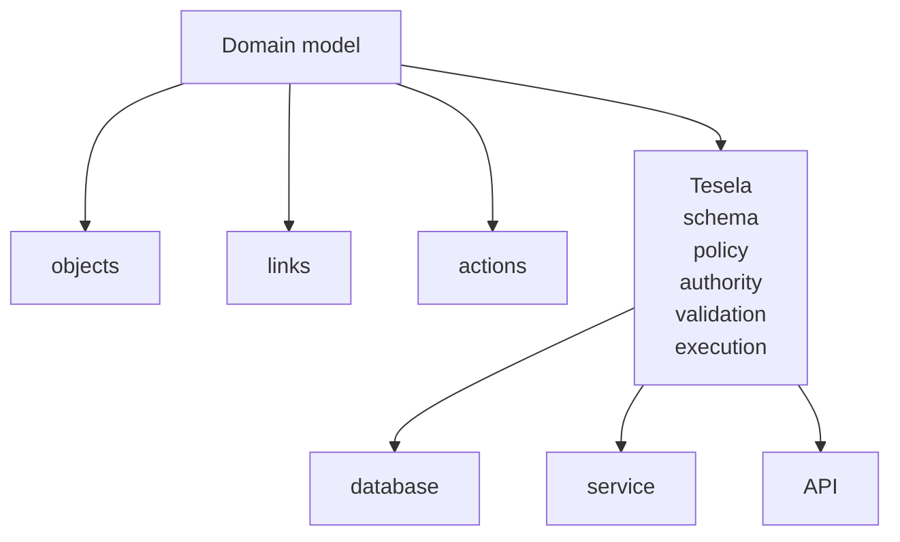

<div align="center">

# Tesela

**One typed, policy-checked interface over the data and services you already have.**

Define objects, relationships, and actions once. Bind them to the systems you already run. Query and execute them through the same semantic runtime from Rust, Python, or agent tooling.

[](#license)
[](https://www.rust-lang.org/)
[](https://www.python.org/)
[](#project-status)

</div>

---

Tesela is an embedded semantic runtime for applications that need to expose existing data and services through one consistent, policy-aware interface.

Your application defines the **meaning** of its domain:

- objects;
- properties;
- relationships;
- actions;
- constraints.

Your application continues to own the **implementation**:

- databases;
- APIs;
- repositories;
- services;
- transactions;
- infrastructure.

Tesela sits between the two.

It compiles the semantic model, binds it to the host's implementations, enforces policy and execution constraints, and exposes the resulting capabilities through the same checked execution path.



## Why Tesela?

Applications increasingly need the same domain operations in several places:

- ordinary application code;
- internal tools;
- automation;
- agent tools;
- administrative interfaces;
- policy-aware workflows.

Without a shared semantic layer, each surface tends to recreate its own query model, validation, authorization, action definitions, and integration logic.

Tesela lets the host define that contract once.

### One semantic model

Objects, links, actions, and constraints have one definition regardless of where their underlying data lives.

### Host-owned infrastructure

Tesela does not require moving application data into a new database or service.

Backends remain ordinary host code.

### Policy on every path

Queries, mutations, traversals, and actions pass through the same authorization and execution machinery.

### Application and agent surfaces from the same contract

Agent-facing capabilities can be projected from the same ontology and policy model used by ordinary application code.

### Rust engine, native Python interface

The execution engine is implemented in Rust. Python uses native PyO3 bindings over the same runtime rather than a separate client architecture.

## Project status

Tesela is currently **pre-1.0**.

The execution model and internal architecture are under active development, and public APIs may change while the Rust and Python contracts are finalized.

The repository currently builds and validates releases from source.

## Quick start

### Python

Define a domain object:

```python
import tesela as ts

@ts.object(key="id")
class Customer:
    id: str
    email: str | None = None
    active: bool = True
```

Bind it to an implementation and create a runtime:

```python
runtime = ts.Runtime(
    {Customer: ts.MemoryBackend()},
    policy=ts.policy.allow_all,
)
context = ts.context("example-service", request_id="request-1")
```

Definitions and plans are immutable. Execution happens only at the runtime boundary:

```python
runtime.run(
    ts.create(Customer(id="c-1", email="a@example.com")),
    context=context,
)

customer = runtime.run(ts.get(Customer, "c-1"), context=context)

plan = (
    ts.query(Customer)
    .where(ts.col("active") & (ts.col("email") == "a@example.com"))
    .limit(10)
)
customers = runtime.run(plan, context=context)
```

Model attributes remain ordinary Python values; expressions begin explicitly with `ts.col(...)` or `ts.lit(...)`. `MemoryBackend` is only a development implementation; production applications bind the same definition to typed repository callbacks or native pushdown integrations.

### Rust

```rust
use tesela::prelude::*;

#[derive(Debug, Clone, PartialEq, Object)]
#[tesela(key = id)]
struct Customer {
    id: String,
    email: Option<String>,
}

fn main() -> Result<(), Error> {
    let runtime = Runtime::builder()
        .object::<Customer>(MemoryBackend::new())
        .policy(tesela::policy::allow_all)
        .build()?;

    let context = Context::builder("example-service")
        .request_id("request-1")
        .build()?;

    runtime.run(create(Customer {
        id: "c-1".into(),
        email: Some("a@example.com".into()),
    }), &context)?;

    let customer = runtime.run(get::<Customer>("c-1".into()), &context)?;

    let plan = query::<Customer>()
        .filter(Customer::email().eq("a@example.com"))
        .limit(10);
    let customers = runtime.run(plan, &context)?;

    Ok(())
}
```

## Mental model

Tesela separates four concerns that are often mixed together.

| Concern | Tesela concept | Example |
| --- | --- | --- |
| What exists? | Object types, links, actions | `Customer`, `CustomerOrders` |
| Where does it come from? | Backend bindings | Postgres repository, HTTP service |
| Who may use it? | Policy + authority | tenant, role, delegated scope |
| Who is calling now? | Execution context | request, service, agent |

This separation is fundamental.

An object declaration never contains a database table name.

A relationship declaration never requires a foreign-key implementation.

An action declaration describes semantics and effects; the host binds the executable implementation separately.

## Objects

Objects define semantic entities.

```rust
#[derive(Object)]
#[tesela(key = id)]
struct Customer {
    id: String,
    email: Option<String>,
    active: bool,
}
```

The declaration describes what a customer means to Tesela.

It does not describe where customers are stored.

The same object may therefore be backed by a database repository, remote service, in-memory implementation, or application-specific adapter.

## Queries

Queries are compiled against the semantic model before reaching a backend.

```rust
let plan = query::<Customer>()
    .filter(Customer::active().predicate() & Customer::email().is_not_null())
    .limit(100);
let customers = runtime.run(plan, &context)?;
```

Unknown fields and invalid operations fail before execution rather than silently reaching a backend.

Backends may execute supported operations natively. Tesela can also provide shared residual execution for integrations that expose simpler scan primitives.

## Links

Links describe relationships independently from their physical implementation.

Conceptually:

```text
Customer ── placed ──▶ Order
```

The relationship may be implemented by:

- a foreign key;
- a join table;
- a graph lookup;
- another service;
- arbitrary application code.

Tesela sees the semantic relationship.

The host owns the resolver.

## Actions

Actions describe executable domain operations.

An action can carry information such as:

- its subject;
- input schema;
- read/write/external effects;
- risk;
- idempotency;
- concurrency expectations.

The declaration and implementation remain separate.

That means the same semantic action can participate in policy decisions and capability discovery without embedding application infrastructure into the ontology.

## Runtime and contexts

A `Runtime` represents compiled application semantics:

```text
Runtime
├── ontology
├── backend bindings
├── action bindings
├── link resolvers
└── policy
```

A `Context` represents one explicit execution authority:

```text
Context
├── principal
├── delegated authority
├── request identity
├── deadline
├── cancellation
└── execution budget
```

The context is immutable and supplied to every execution. Tesela never invents a default principal or request identity. This keeps request-specific state explicit without requiring applications to rebuild the runtime for every call.

`Runtime.run(plan, context)` returns the useful typed value. `Runtime.execute(plan, context)` returns that value together with its receipt and optional revision. Revisions never become hidden model attributes.

## Policy and authority

Policy is evaluated by the runtime and enforced by the runtime.

A policy decision may:

- allow an operation;
- deny it;
- restrict visible rows;
- redact properties;
- constrain execution.

Tesela applies these restrictions through the same checked path used by reads, mutations, traversals, and actions.

Execution contexts can additionally carry delegated authority, expiry, cancellation, deadlines, and resource budgets.

## Capabilities for agents

Tesela can derive actor-specific capabilities from:

```text
ontology
+ bindings
+ authority
+ policy
+ action effects
+ task relevance
```

The resulting catalog describes what a caller can actually do rather than merely listing every operation that exists. Each capability carries:

- `input_schema`: a JSON Schema derived from the object's properties, so tool-calling models get real argument shapes.
- `annotations`: MCP-style hints (`read_only`, `destructive`, `idempotent`, `open_world`) derived from action effects and mutation risk.
- `risk`, `approval_required`, `requires_revision` and `preconditions`, so callers can see what a call will need before making it.
- `exposure`: `direct`, `discoverable`, `program_only` or `hidden`. Exposure is decided by whole-token matching of the task against the resource and operation verbs, so `customers` does not promote `customer`. Denied capabilities are always `hidden`.

Invoke a capability with `Runtime::invoke` (Rust) or `Runtime.invoke` (Python). Invocations route to the same checked paths as typed plans, so policy, authority, approvals and revision checks still apply. Results come back inline, or as a bounded, execution-scoped handle that exposes only an id and count.

Catalogs and invocations carry the ontology fingerprint and generation. A stale invocation fails with a message that names both generations and says to fetch the catalog again with `Runtime::capabilities`.

This allows ordinary application code and agent tooling to share the same underlying authority and execution model.

## Existing infrastructure stays yours

Tesela is not a database.

It does not own your connection pool, transaction manager, HTTP client, message bus, application services, or deployment model.

A backend implements the operations its underlying system can perform.

```text
Tesela semantic operation
          │
          ▼
   host backend binding
          │
    ┌─────┼─────┐
    ▼     ▼     ▼
 Postgres API  service
```

Unsupported operations fail explicitly rather than being silently synthesized from weaker primitives where doing so would change semantics.

## Compiled execution model

At runtime construction, Tesela compiles semantic names into dense internal identifiers and resolves them to their corresponding backend, link, and action handles.

The resulting runtime snapshot is immutable.

Readers access the active snapshot without taking a global runtime lock, while replacement ontologies are fully compiled and bound before publication.

A failed replacement therefore leaves the previous valid runtime in service.

## Execution receipts

Checked executions can produce machine-readable receipts describing what happened.

Receipts make execution observable without turning observation callbacks into the durability mechanism.

Applications requiring durable audit trails should commit them through the same transaction or outbox discipline used for the operation being audited.

## Performance model

Tesela is designed so semantic abstraction does not require repeatedly rediscovering runtime structure.

Important properties include:

- semantic names resolve during compilation;
- runtime snapshots are immutable;
- active snapshot reads avoid a global lock;
- filters are compiled before backend execution;
- bounded scans can terminate early;
- bounded sorting retains only the required candidate set;
- residual aggregation retains aggregate state rather than full groups;
- backend-native atomic operations remain native.

Benchmark methodology and sources are documented under [`benchmarks/`](benchmarks/).

Performance claims should be interpreted together with the workload, backend, hardware, and Tesela revision used to produce them.

## Rust architecture

The workspace is divided by responsibility:

```text
tesela-core        common values, identity, errors, execution primitives
tesela-ir          semantic declarations and query representation
tesela-backend     backend and policy contracts
tesela-runtime     compilation and checked execution
tesela-capability  capability projection
tesela-macros      declarative Rust macros
tesela             curated Rust API
tesela-py          native Python boundary
```

Applications should normally depend on the `tesela` facade rather than individual engine crates.

## Python architecture

The Python package is a native facade over the Rust runtime.

```text
Python models and expressions
          │
          ▼
      tesela._native
          │
          ▼
    Rust runtime engine
```

Python owns declaration ergonomics, model materialization, expression syntax, and Python callback adaptation.

Compilation, policy enforcement, authority checks, backend dispatch, and execution remain in the Rust engine.

## Development

Clone the repository and verify the complete workspace:

```bash
make verify
```

The verification pipeline includes:

- Rust formatting;
- Clippy with warnings denied;
- workspace tests;
- documentation builds;
- benchmark smoke tests;
- Python tests;
- Pyright;
- Python package builds;
- wheel builds;
- release checks.

Individual Rust tests can be run with:

```bash
cargo test --workspace
```

Python bindings can be developed locally with Maturin.

## Security

Tesela sits on an authorization and execution boundary, so security behavior is considered part of the runtime contract.

See [`SECURITY.md`](SECURITY.md) for the documented trust boundaries, guarantees, and reporting process.

## License

Tesela is released under the [Apache License 2.0](LICENSE).
